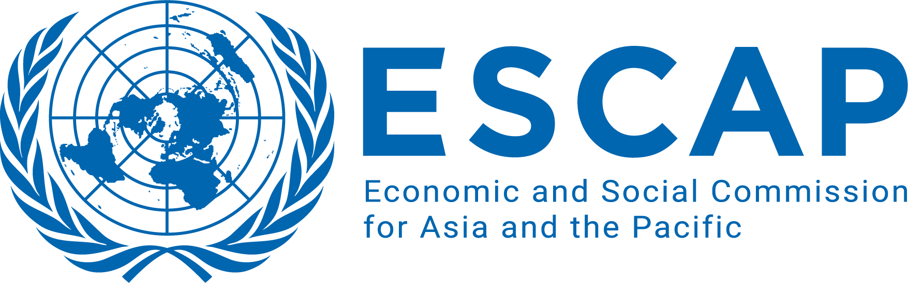
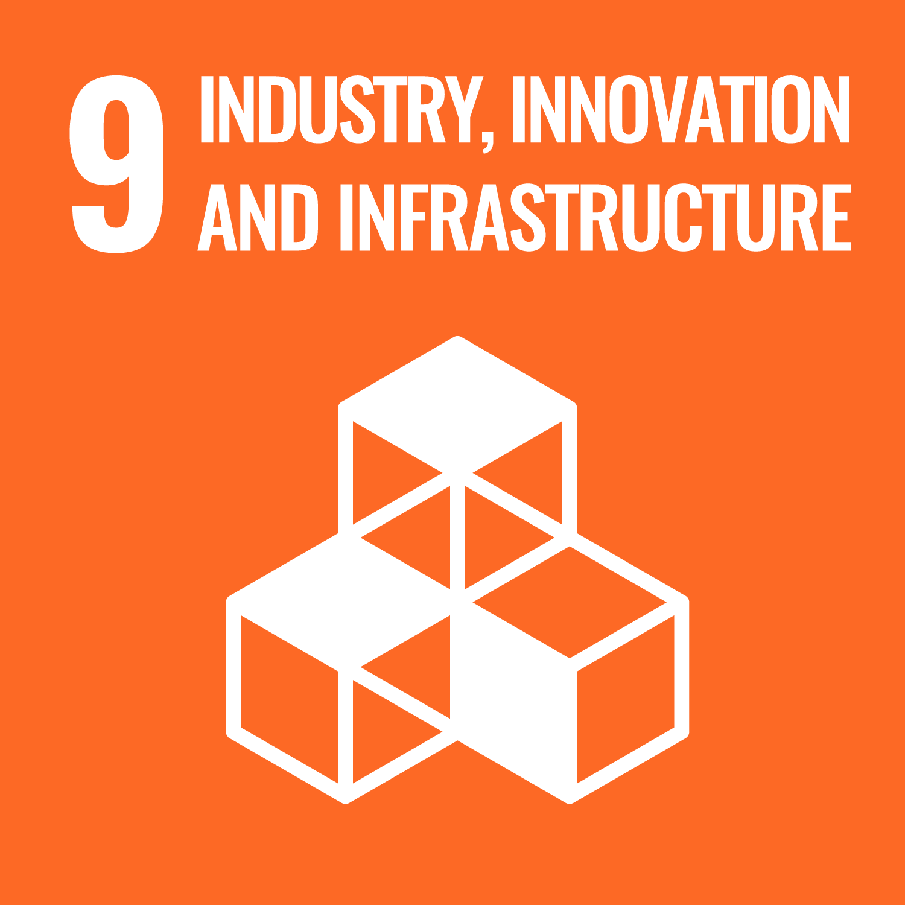

::: {.columns .home-logos-split}

::: {.column}
{.home-logo .escap}
:::

::: {.column style="text-align: right;"}
{.home-logo .sdg9}

:::

:::

# Key Recommendations

- **Data availability and quality:** The accuracy of SDG 9.1.1 heavily relies on the quality and availability of disaggregated, geocoded rural population data and accurate, up-to-date all-season road network data. Efforts should focus on acquiring or developing these foundational datasets to ensure their quality.
- **Definition of "all-season road":** Countries should establish a clear and consistent national definition of "all-season road" that considers local climatic conditions and road engineering standards in line with the SDG 9.1.1 metadata. If direct seasonality data is unavailable, clear proxies should be documented and consistently applied.
- **Spatial reference systems:** Maintain consistency in spatial reference systems across all input datasets to ensure accurate geospatial operations.
- **Scalability:** The methodology described is scalable. While demonstrated for a sub-national area, it can be applied to the entire national extent, provided sufficient computational resources and data are available.
- **Validation:** Regularly validate the derived indicator results against other relevant national statistics or ground truth data to ensure accuracy and reliability.

# Conclusion

This guide provides a robust and replicable methodology for calculating SDG indicator 9.1.1 using a widely available open-source GIS software (QGIS) and national geospatial datasets. By following these steps, National Statistics Offices and GIS professionals can effectively estimate rural access to all-season roads in their respective countries.

**Additional information:** The guide was developed by Elena Hristev, ESCAP Consultant. For more details, you may contact her directly at lena.hristev@gmail.com or contact ESCAP Statistics Division at stat.unescap@un.org

