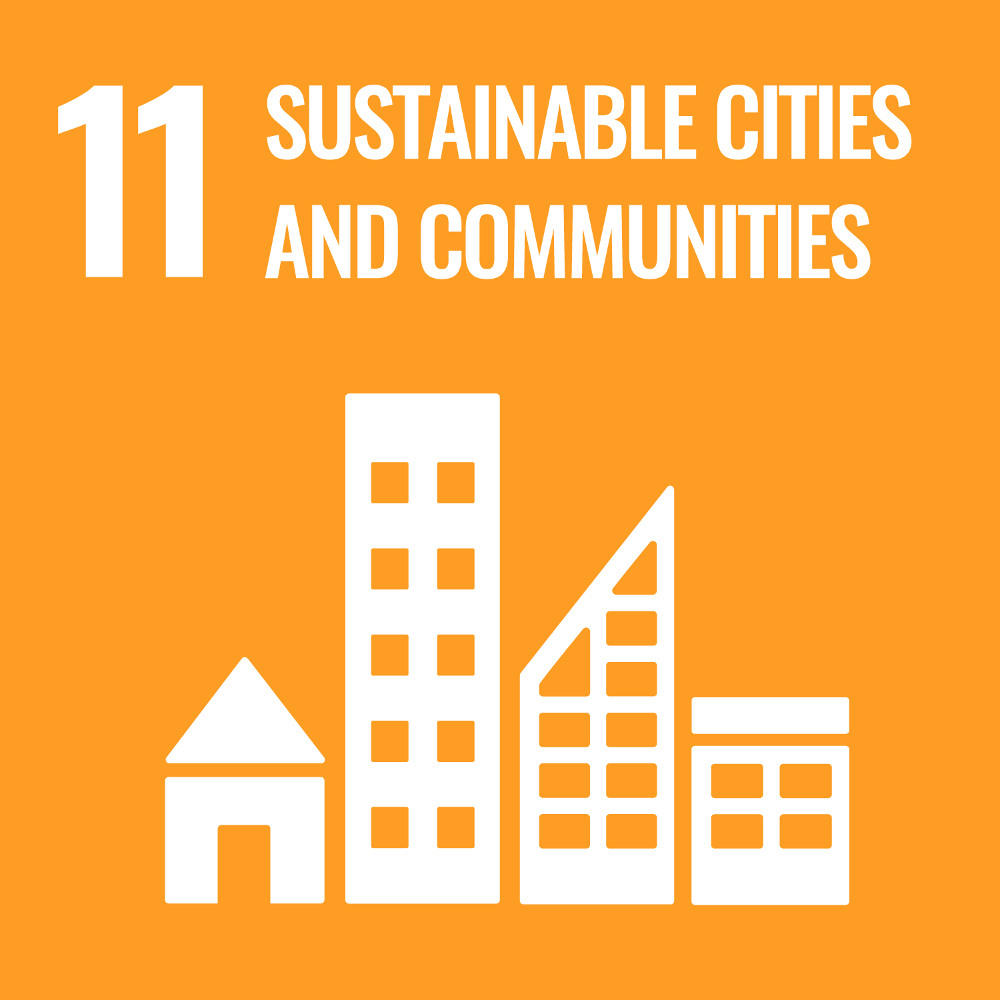
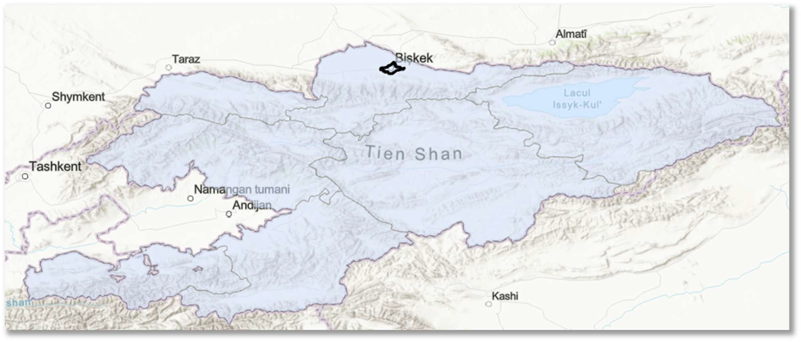

::: {.columns .home-logos-split}

::: {.column}
{.home-logo .escap}
:::

::: {.column style="text-align: right;"}
{.home-logo .sdg11}

:::

:::

::: {.logo-heading}
Step-by-step Guide on Estimating SDG 11.3.1 Using Geospatial Data

:::

This guide was developed by the Statistics Division, ESCAP based on the technical support on Big Data and Data Science for Official Statistics in Asia and the Pacific provided to the National Statistical Committee of the Kyrgyz Republic with funding support from the UN Peace and Development Trust Fund. The guide details a step-by-step process to estimate SDG indicator 11.3.1 “Ratio of land consumption rate to population growth rate” using geospatial data. While this guide utilizes open-source and national datasets from Kyrgyzstan as a practical case study, the underlying methodology is designed to be universally applicable for any country and territory with access to similar geospatial datasets. For illustrative purposes, the guide focuses on the City of Bishkek in Kyrgyzstan as a practical case study. The Degree of Urbanisation (DEGURBA) methodology, which defines the urban territories used for analysis in this guide, is in line with global metadata standards, ensuring consistency and comparability across different regions.

