::: {.columns .home-logos-split}

::: {.column}
{.home-logo .escap}
:::

::: {.column style="text-align: right;"}
{.home-logo .sdg11}

:::

:::

# Step 2: Calculating Land Consumption Rate

This section focuses on preparing land use/land cover data to derive built-up area statistics for different time periods.

**5. Navigate to project folder in QGIS browser:** In the 'Browser' panel (typically on the left), navigate to your newly created project folder (e.g., D:/SDG_1131_Project).

**6. Add vector and raster layers to map:** Select (click) and drag-and-drop the relevant shapefiles and rasters from your project folder into the QGIS map canvas. For the Kyrgyzstan example, these would include the following (as shown in the picture below): GHS-DUG_URBAN_CENTRE_UTM44N.shp (DEGURBA urban areas for selected city, e.g., Bishkek), Chuy_UTM44N.shp (Chuy region boundary), LULC_2017_Mozaica.tif (Esri LULC for 2017), and LULC_2020_Mozaica.tif (Esri LULC for 2020)

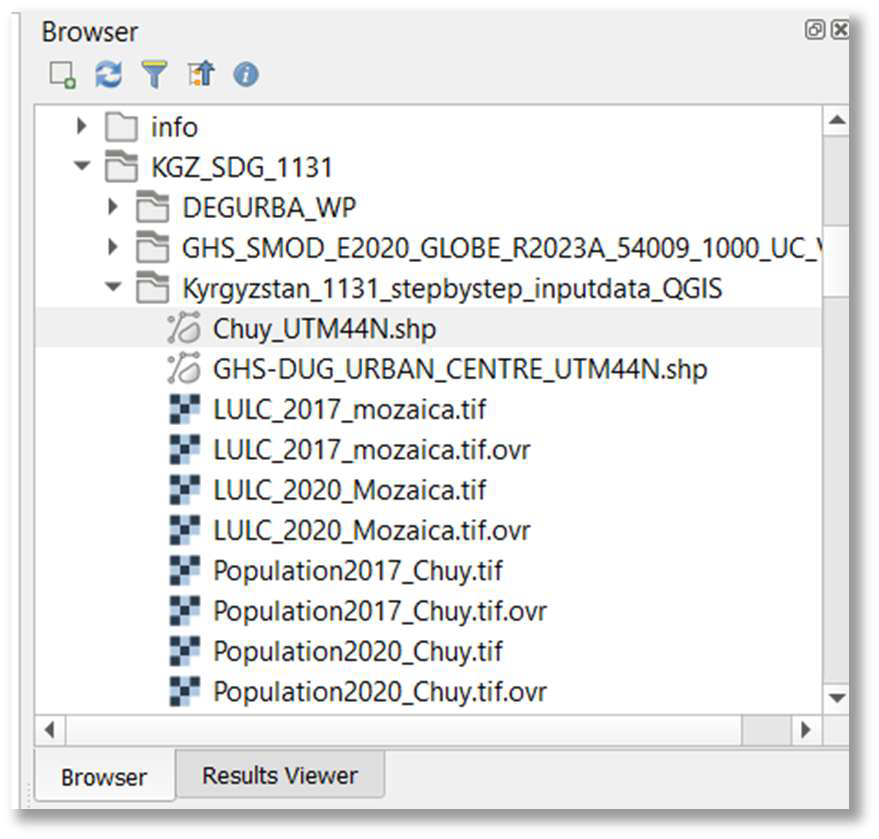

**7. Save QGIS project:** Save your QGIS project (e.g., as SDG_1131_Analysis.qgz) in your project folder (e.g., D:/SDG_1131_Project, or the name of your choosing).

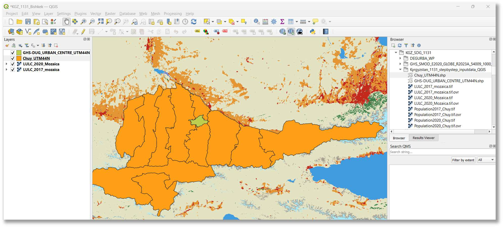

**8. Clip Land Use Land Cover (LULC) for 2017 to the region of interest:** To focus the analysis on your specific region, clip the broader LULC grid for 2017 to your chosen administrative boundary (e.g., Chuy region).

- Choose Raster > Extraction > Clip Raster by Mask Layer.
- Set 'Input layer' to LULC_2017_Mozaica.tif.
- Set 'Mask layer' to your regional boundary (e.g., Chuy_UTM44N).
- Ensure 'Match the extent of the clipped raster to the extent of the mask layer' is checked.
- Specify an 'Output file' path and name (e.g., D:/SDG_1131_Project/LULC_2017_Chuy.tif).
- Click 'Run'.

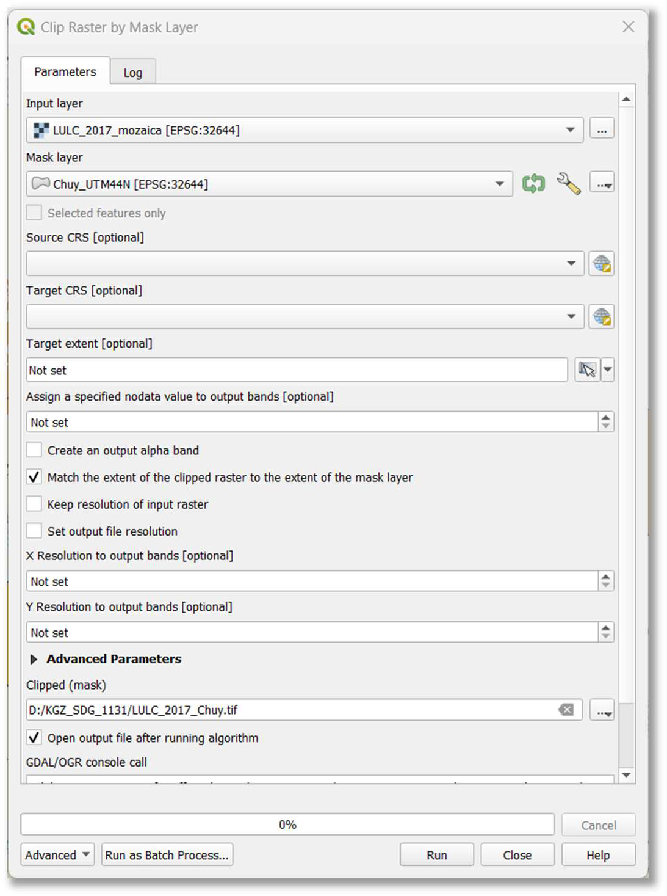

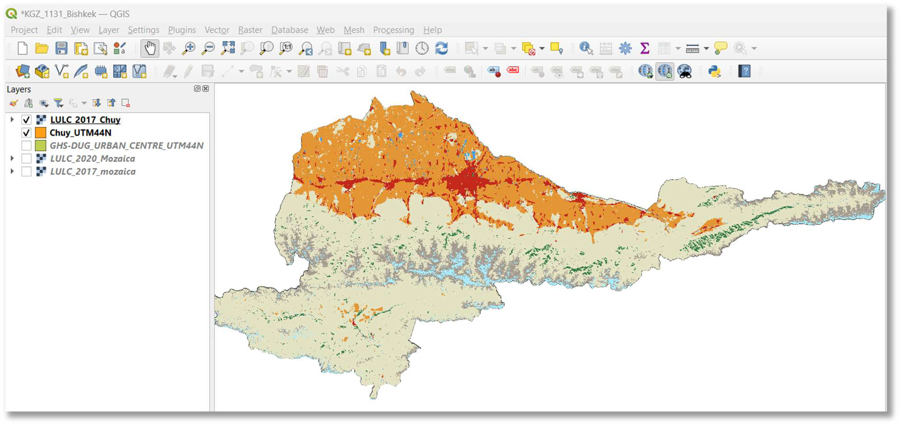

**9. Clip Land Use Land Cover (LULC) for 2020 to the region of interest:** Repeat step 8 for the LULC_2020_Mozaica.tif dataset to generate a clipped raster named LULC_2020_Chuy.tif (or similar, reflecting your region).

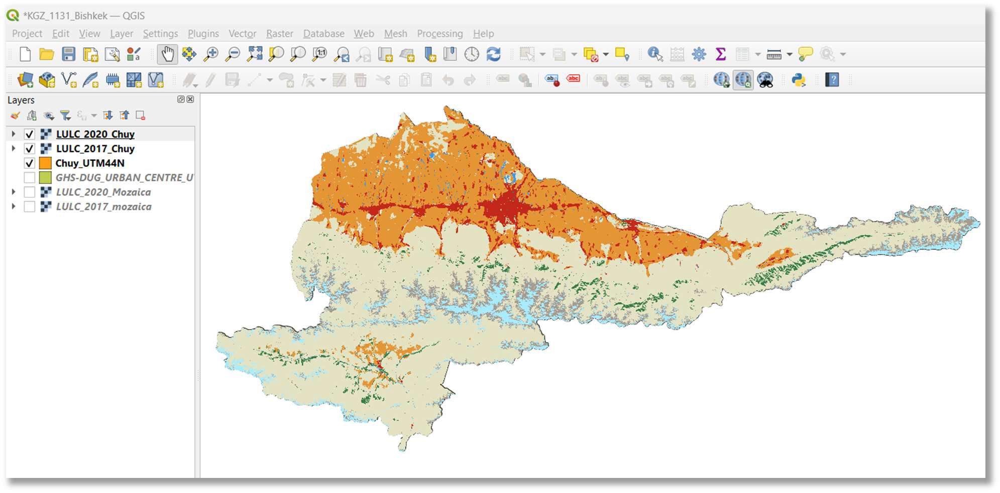

**10. Isolate built-up areas using raster calculator:** For each clipped LULC raster (2017 and 2020), select only the built-up areas. Esri Land Use Land Cover data typically assigns a specific class value to built-up areas (e.g., class 7).

- Launch Raster > Raster Calculator.
- **For 2017:**
  - Enter the expression: ("LULC_2017_Chuy@1" = 7) * "LULC_2017_Chuy@1"
  - This expression creates a new raster where only pixels with a value of 7 (built-up areas) retain their value, and all other values become 0.
  - Specify an 'Output layer' path and name (e.g., D:/SDG_1131_Project/LULC_2017_Chuy_builtup.tif).
  - Please note that this output layer is used as an input layer in the methodology to produce DEGURBA. More guidance is provided in the series of guides published by ESCAP.
  - **IMPORTANT NOTE:** To produce accurate results and ensure the output is a permanent file, **ALWAYS create a physical raster dataset** by specifying an output file path. Do not leave the 'Create on-the-fly raster instead of writing layer to disk' option selected.
  - Click 'OK'.
- **For 2020:**
  - Repeat the process with the expression: ("LULC_2020_Chuy@1" = 7) * "LULC_2020_Chuy@1"
  - Specify the output as D:/SDG_1131_Project/LULC_2020_Chuy_builtup.tif.
  - Click 'OK'.

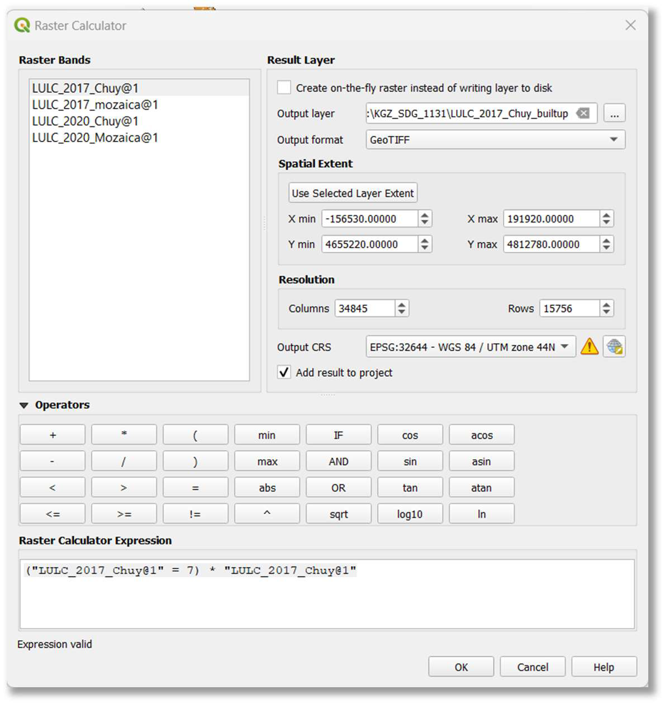

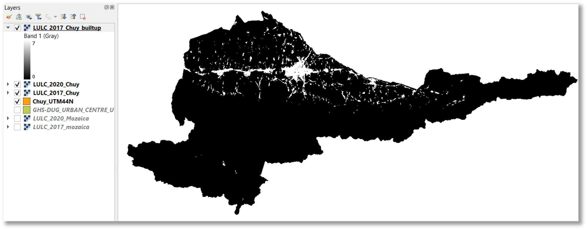

**NOTE:** Built-up areas are in white. To produce accurate results ALWAYS create physical raster dataset **within the Raster Calculator**. Do not leave set up properties to create on-the-fly raster.

**11. Remove zero values (prepare for analysis):** To ensure only built-up areas are considered and to prepare the grids for accurate area calculation, remove zero-value cells from the built-up rasters obtained in the previous step. This effectively creates a binary mask where built-up areas have a value (e.g., 7) and non-built-up areas are null or ignored.

- Launch Raster > Raster Calculator.
- **For 2017:**
  - Enter the expression: ("LULC_2017_Chuy_builtup@1") / ("LULC_2017_Chuy_builtup@1" > 0)
  - Specify the output as D:/SDG_1131_Project/LULC_2017_Chuy_builtup_final.tif.
  - Click 'OK'.
- **For 2020:**
  - Repeat the process with the expression: ("LULC_2020_Chuy_builtup@1") /
("LULC_2020_Chuy_builtup@1" > 0)
  - Specify the output as D:/SDG_1131_Project/LULC_2020_Chuy_builtup_final.tif.
  - Click 'OK'.

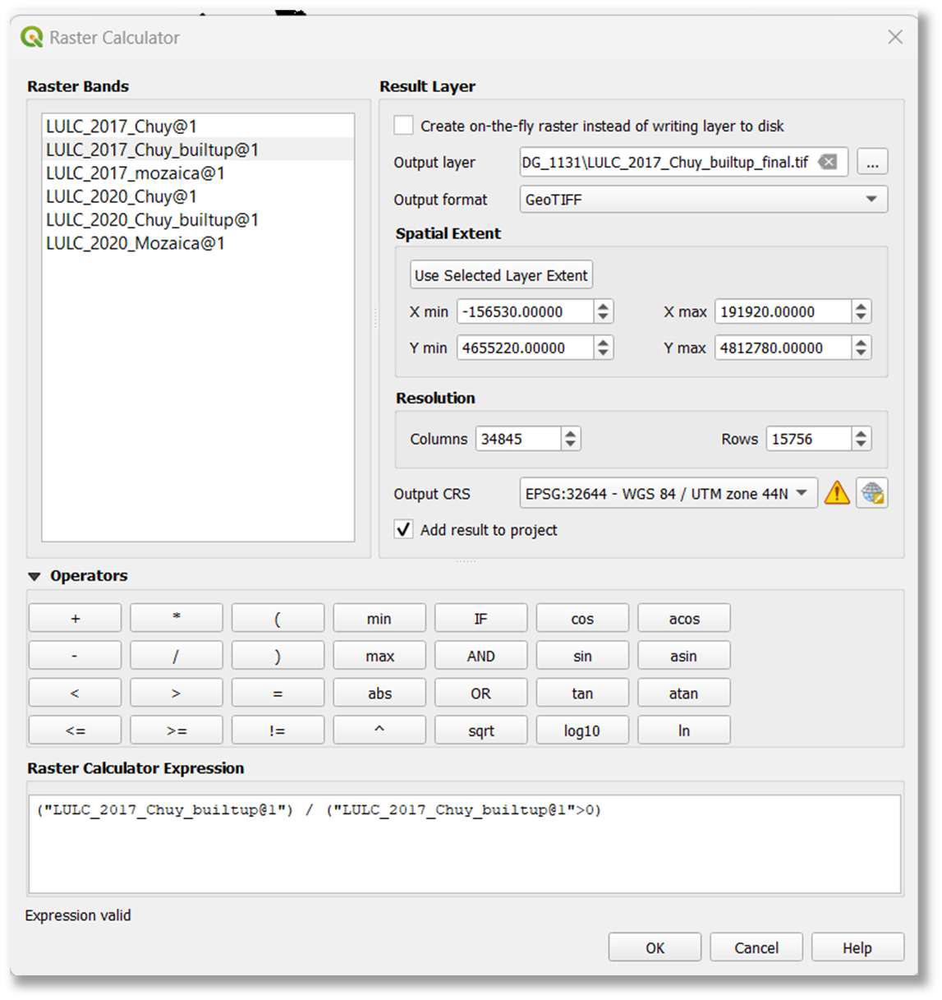

**NOTE:** You can use a variety of data sources for Built-up areas. It is essential to analyze the data and its quality. For example, upon validation, GHS (Global Human Settlement) datasets from the Copernicus data portal could be used. Specialists could also generate their own Built-up areas using the Sentinel Hub Plugin in QGIS or via Google Earth Engine (refer to materials from UN-Habitat).

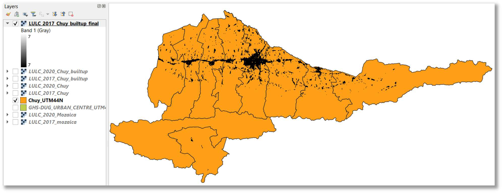

**12. Calculate built-up area (m^2^) for 2017 within urban boundaries:** Identify the total area (in square meters) covered by built-up areas within the boundaries of your defined urban zones (DEGURBA areas) for the year 2017.

- In the 'Processing Toolbox' (accessible via Processing > Toolbox), search for "Zonal statistics" and choose Raster analysis > Zonal statistics.
- Set 'Input layer' to your DEGURBA urban area shapefile (e.g., GHS-DUG_URBAN_CENTRE_UTM44N).
- Set 'Raster layer' to your final 2017 built-up raster (e.g., LULC_2017_Chuy_builtup_final).
- Set 'Raster band' to Band 1 (Grey).
- Under 'Statistics to calculate', ensure 'Count' and 'Sum' are selected. (The original document also shows 'Mean', but 'Count' and 'Sum' are most relevant for total area calculation in a binary raster).
- Specify an 'Output column prefix' (e.g., BU_2017_).
- Specify an 'Output file' path and name for the new shapefile (e.g.,
D:/SDG_1131_Project/Bishkek_BU_2017_zonalstatistics.shp).
- Click 'Run'.

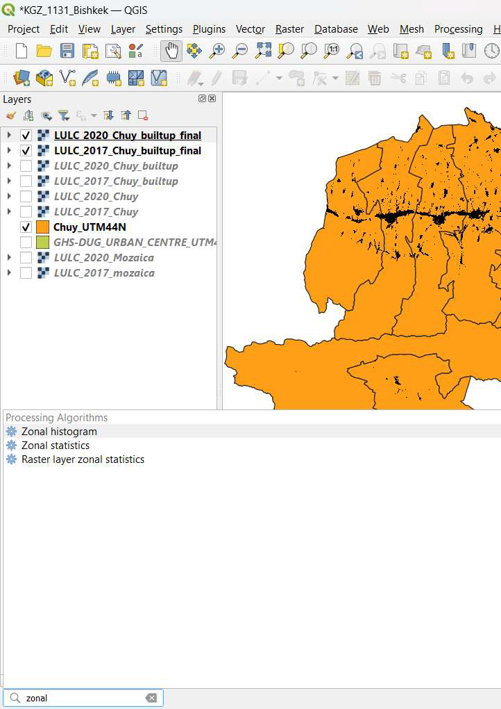

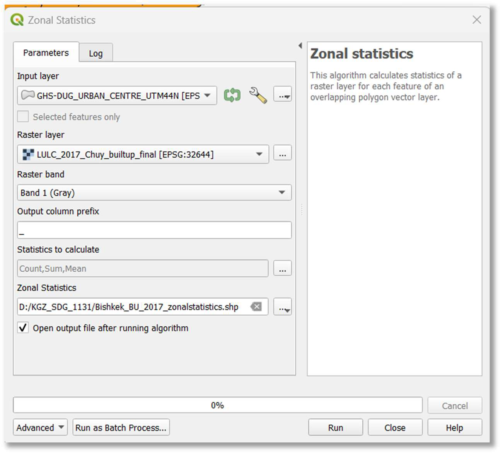

Below is a zoomed-in view of the built-up areas and DEGURBA boundary.

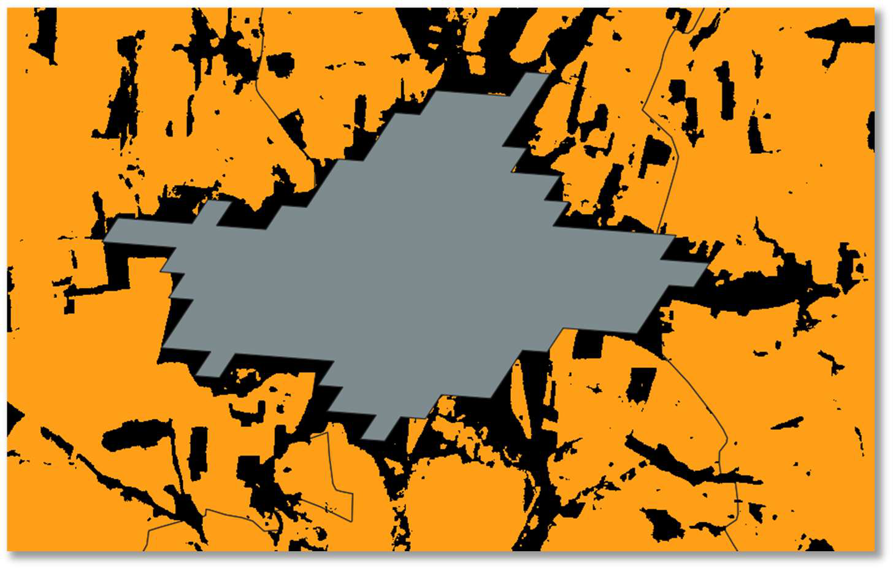

**13. Review 2017 built-up area statistics:** Right-click on the newly created Bishkek_BU_2017_zonalstatistics layer in the 'Layers' panel and select 'Open Attribute Table'.

- The 'count' field in the attribute table represents the number of built-up raster cells within your DEGURBA urban area. Given that the Esri LULC data is at 10x10 m resolution, each cell represents 100 m^2^.
- Multiply the 'count' value by 100 to get the total built-up area in square meters. For example, if the count is 1482382, the area is 1482382 * 100 = 148,238,200 m^2^, or 148.2382 km^2^. This is the total built-up area for Bishkek in 2017.

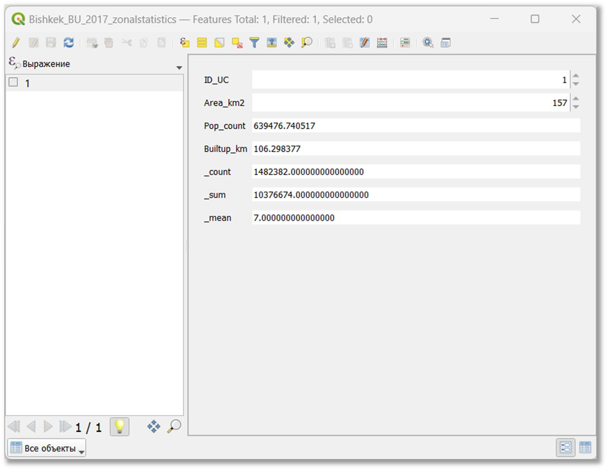

**14. Calculate Built-up Area (m^2^) for 2020 within Urban Boundaries:** Repeat steps 12 and 13 to calculate the built-up area statistics for Bishkek in 2020.

- Use LULC_2020_Chuy_builtup_final as the 'Raster layer'.
- Specify a new output shapefile (e.g., D:/SDG_1131_Project/Bishkek_BU_2020_zonalstatistics.shp).
- Review the attribute table. The example shows a value of 1527060 for the count, resulting in 152,706,000 m^2^ or 152.706 km^2^ of built-up areas in Bishkek in 2020.

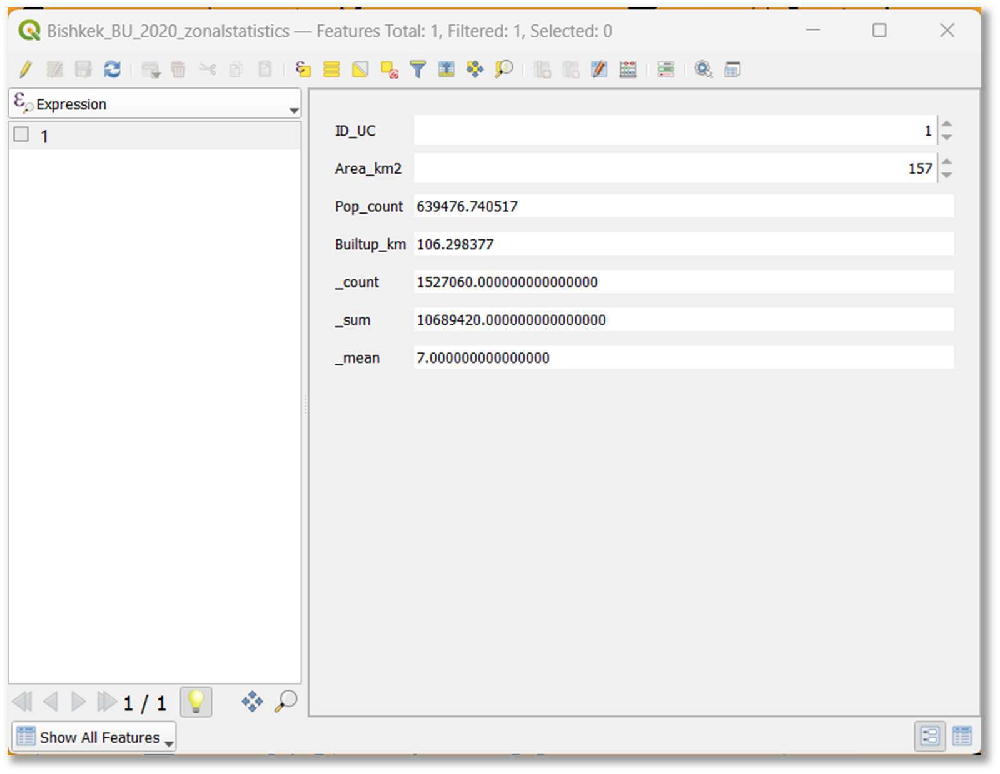

