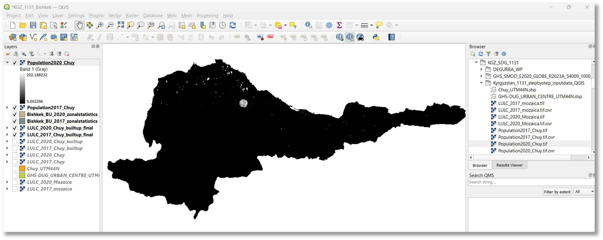
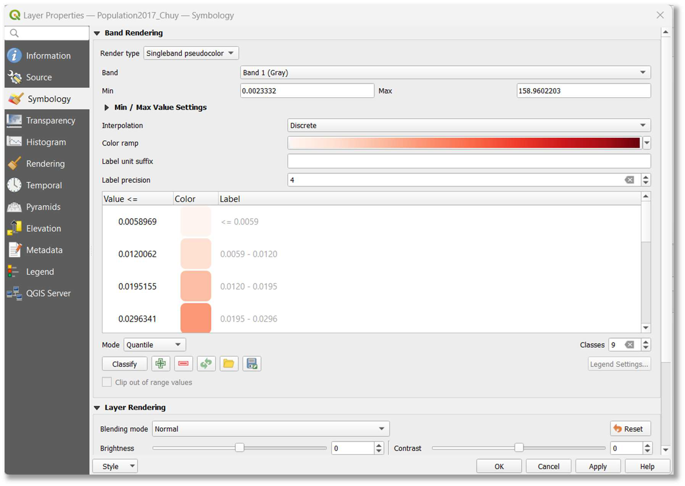
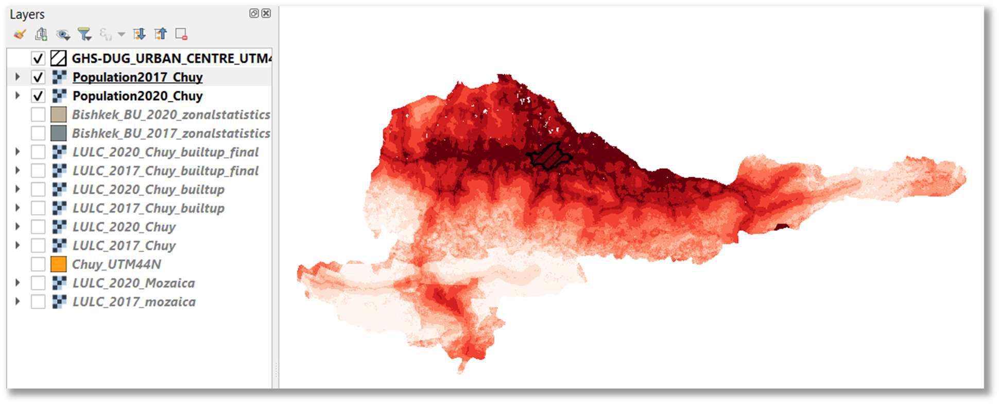
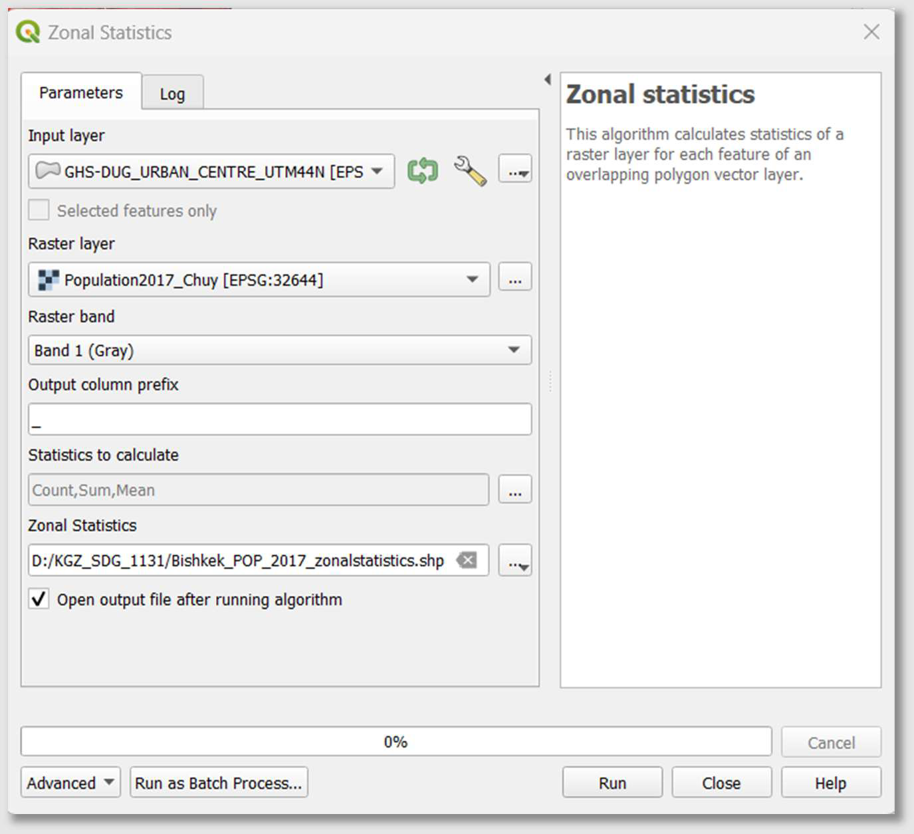
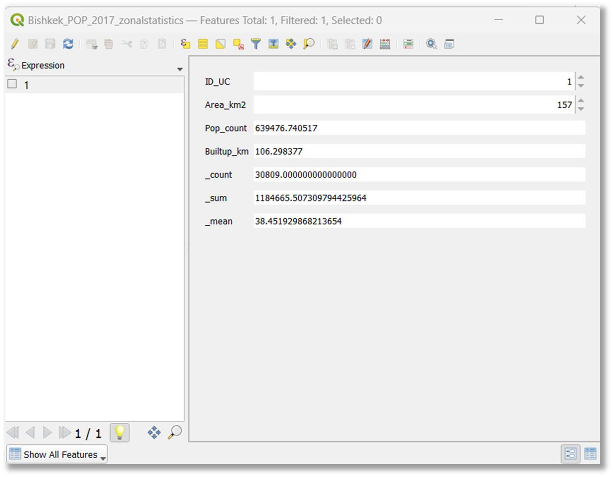
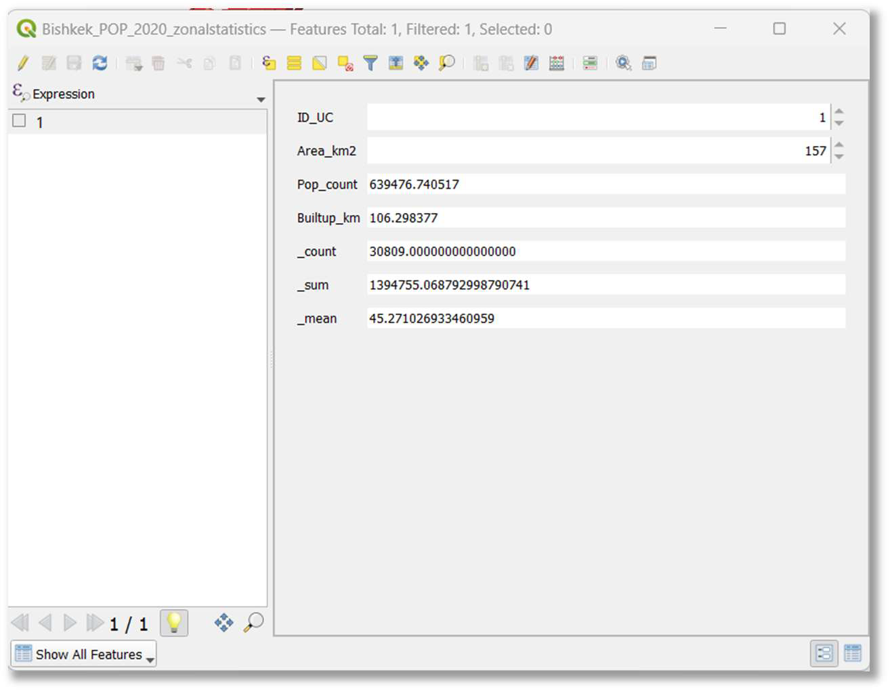

::: {.columns .home-logos-split}

::: {.column}
{.home-logo .escap}
:::

::: {.column style="text-align: right;"}
{.home-logo .sdg11}

:::

:::

# Step 3: Calculating Population Growth Rate (PGR)

This section focuses on preparing population grid data to derive population statistics for different time periods within your urban areas.

**15. Add WorldPop raster datasets to map:** Add the WorldPop raster datasets for 2017 and 2020 to your QGIS map canvas (e.g., drag-and-drop Population2017_Chuy.tif and Population2020_Chuy.tif).

**16. Enhance population grid visualization (symbology):** To better understand the population distribution within the grids, change the symbology for both raster layers.

- Right-click each population layer in the 'Layers' panel and select Properties > Symbology.
- Set 'Render type' to 'Singleband pseudocolor'.
- Under 'Min / Max Value Settings', choose an appropriate 'Interpolation' (e.g., 'Discrete' or 'Linear') and 'Color ramp' (e.g., 'Reds' for population density).
- Adjust 'Mode' (e.g., 'Quantile' or 'Equal Interval') and 'Classes' to define visual ranges.
- Click 'Apply' then 'OK'.

The image below shows the visualized population grid:

**17. Calculate population statistics for 2017 and 2020 within urban boundaries:** Run the Zonal statistics tool for both Population2017_Chuy.tif and Population2020_Chuy.tif rasters. This will sum the population values within your DEGURBA urban areas for each year.

- In the 'Processing Toolbox', search for "Zonal Statistics" and choose Raster analysis > Zonal Statistics.
- **For 2017:**
  - Set 'Input layer' to your DEGURBA urban area shapefile (e.g., GHS-DUG_URBAN_CENTRE_UTM44N).
  - Set 'Raster layer' to Population2017_Chuy.tif.
  - Under 'Statistics to calculate', ensure 'Sum' is selected.
  - Specify the output shapefile as D:/SDG_1131_Project/Bishkek_POP_2017_zonalstatistics.shp.
  - Click 'Run'.
- **For 2020:**
  - Repeat the process with 'Raster layer' set to Population2020_Chuy.tif.
  - Specify the output shapefile as D:/SDG_1131_Project/Bishkek_POP_2020_zonalstatistics.shp.
  - Click 'Run'.

**18. Review population statistics for 2017 and 2020:** Open the attribute tables for the layers Bishkek_POP_2017_zonalstatistics and Bishkek_POP_2020_zonalstatistics to obtain the total population values for Bishkek in 2017 and 2020, respectively.

- For 2017, the example shows a sum of 1184665.50..., which translates to approximately 1,184,665 inhabitants.

- For 2020, the example shows a sum of 1394755.06..., which translates to approximately 1,394,755 inhabitants.

**NOTE:** Creating a population spatial grid based on national census data and adopting this methodology can result in advanced spatial insights and further in-depth analysis related to land consumption and population dynamics in urban areas.
