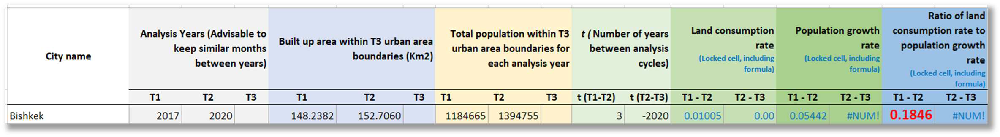

::: {.columns .home-logos-split}

::: {.column}
{.home-logo .escap}
:::

::: {.column style="text-align: right;"}
{.home-logo .sdg11}

:::

:::

# Step 4: Calculating SDG 11.3.1 “Ratio of land consumption rate to population growth rate”

To calculate SDG 11.3.1 for your urban area (e.g., Bishkek), it is highly recommended to use the official SDG 11.3.1 Reporting Template provided by the custodian agency, UN-Habitat.

**19. Download SDG 11.3.1 Reporting Template:** Obtain the Excel file from the official sources (e.g., https://data.unhabitat.org/). Search for "SDG 11.3.1 Reporting Template." Download and save the Excel file with your preferred name.

**20. Input data into the Reporting Template:** In the Excel file, navigate to the Tab '2-Indicator 11.3.1 data inputs'. Input the numbers obtained from the previous steps into the corresponding cells to calculate SDG 11.3.1:

- **Built up area within T3 urban area boundaries (km^2^):**
  - T1 (2017): Input the value from Step 14 (e.g., 148.2382).
  - T2 (2020): Input the value from Step 14 (e.g., 152.7060).
- **Total population within T3 urban area boundaries for each analysis year:**
  - T1 (2017): Input the value from Step 18 (e.g., 1,184,665).
  - T2 (2020): Input the value from Step 18 (e.g., 1,394,755).
- **T (Number of years between analysis cycles):** Input the number of years
between T1 and T2 (e.g., 3 for 2017-2020).

The Excel template will automatically calculate the Land Consumption Rate, Population Growth Rate, and the final Ratio of land consumption rate to population growth rate.

