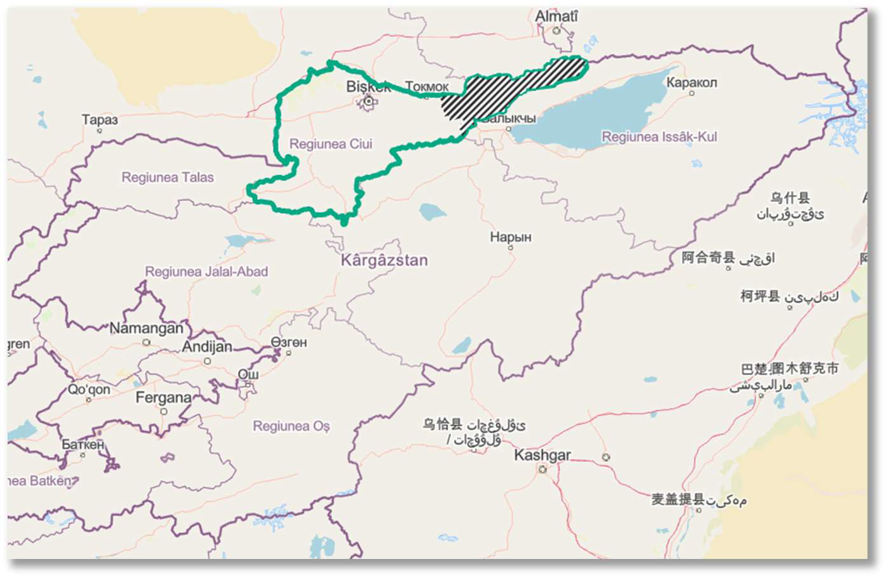

::: {.columns .home-logos-split}

::: {.column}
{.home-logo .escap}
:::

::: {.column style="text-align: right;"}
{.home-logo .sdg9}

:::

:::

::: {.logo-heading}
Step-by-step Guide on Estimating SDG 9.1.1 Using Geospatial Data

:::

This guide was developed by the Statistics Division, ESCAP based on the technical support on Big Data and Data Science for Official Statistics in Asia and the Pacific provided to the National Statistical Committee of the Kyrgyz Republic with funding support from the UN Peace and Development Trust Fund. The guide details a step-by-step process to estimate SDG indicator 9.1.1 “Proportion of rural population who live within 2 km of all-season road” using geospatial data. While this guide utilizes national datasets from Kyrgyzstan as a practical case study, the underlying methodology is designed to be universally applicable for any country and territory with access to similar geospatial datasets. The methodology aims to offer a reproducible and automated approach for National Statistics Offices (NSOs) and GIS professionals worldwide to estimate and report on this important SDG indicator. The case study in this guide focuses on a pilot area in Kyrgyzstan (Kemin rayon of Chuy region), but the model is scalable and can be extrapolated to the national level.

