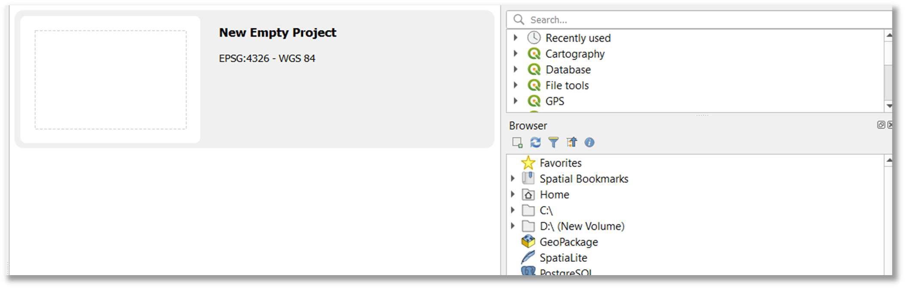

::: {.columns .home-logos-split}

::: {.column}
{.home-logo .escap}
:::

::: {.column style="text-align: right;"}
{.home-logo .sdg9}

:::

:::

# Step 1: Preparing Geodata

The methodology below is presented in a step-by-step approach from data processing to indicator calculation, primarily using QGIS. Step 1 ensures all necessary data is organized and accessible within your QGIS environment.

**1. Create a dedicated project folder:** Create a new folder on your local drive (e.g., D:/SDG_911_Project). This folder will house all your input and output data.

**2. Download and unzip data:** Download all required spatial datasets (identifying relevant national or open global sources for your area, similar to the examples referenced above). Unzip all downloaded files into your local drive (e.g. the D:/SDG_911_Project folder created earlier).

**3. Launch QGIS:** Open the QGIS Desktop application.

**4. Start a new empty project:** Choose (double-click) "New Empty Project" from the QGIS initial screen or navigate to Project > New Empty Project.

