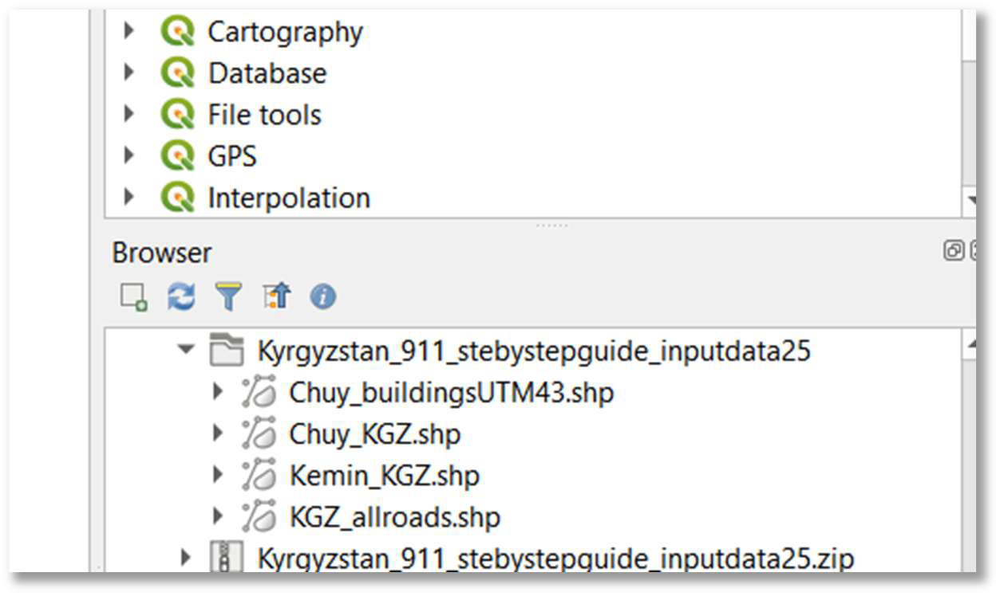
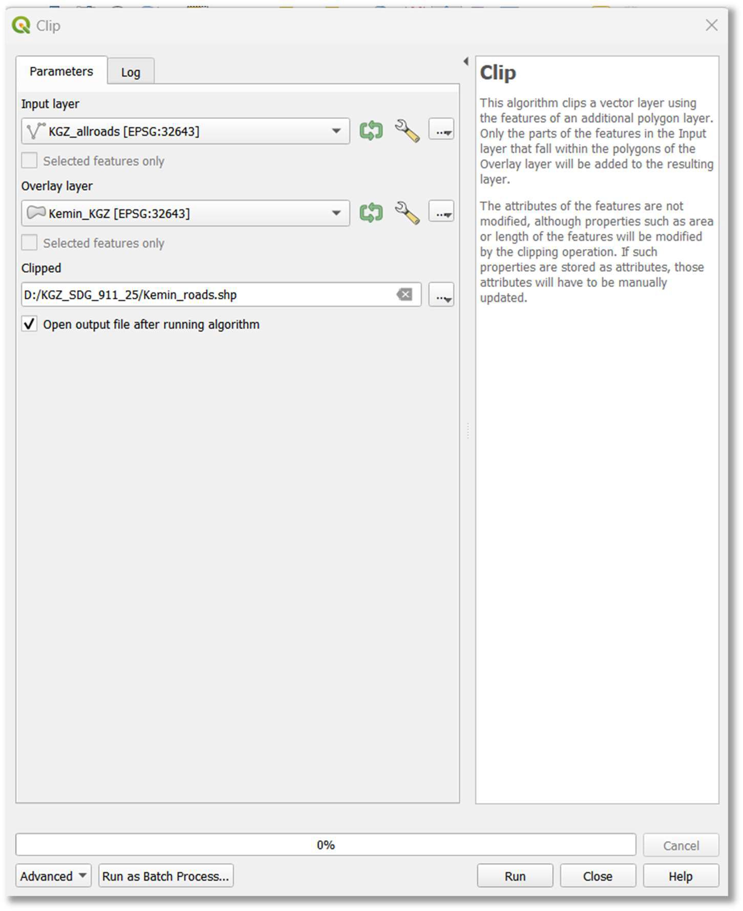
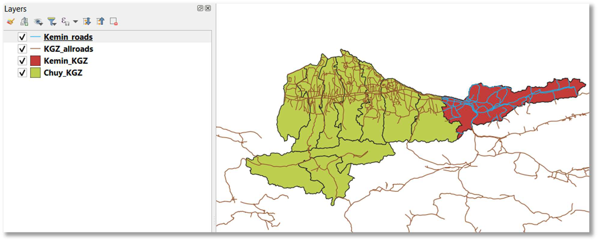
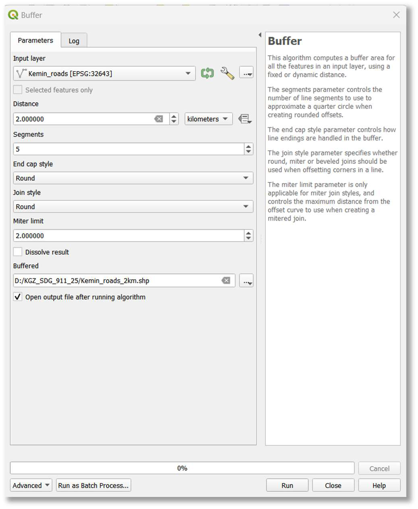
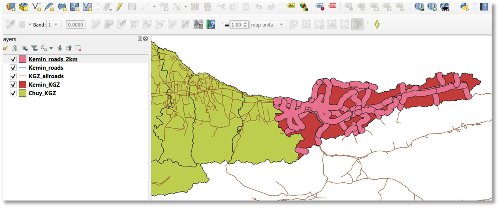

::: {.columns .home-logos-split}

::: {.column}
{.home-logo .escap}
:::

::: {.column style="text-align: right;"}
{.home-logo .sdg9}

:::

:::

# Step 2: Road Network Geodata Processing and Analytics

This section focuses on preparing the road network data for analysis, including clipping to a specific area and creating a buffer zone.

**5. Navigate to project folder in QGIS browser:** In the 'Browser' panel (typically on the left), navigate to your newly created project folder (e.g., D:/SDG_911_Project).

**6. Add vector layers to map:** Select (click) and drag-and-drop the relevant shapefiles from your project folder into the QGIS map canvas. For the Kyrgyzstan example, these would be Chuy_KGZ.shp (Chuy region boundary), Kemin_KGZ.shp (Kemin rayon boundary), and KGZ_allroads.shp (all-season roads).

**7. Save QGIS project:** Save your QGIS project (e.g., as SDG_911_Analysis.qgz) in your project folder (e.g., D:/SDG_911_Project).

**8. Clip roads to area of interest (optional for national-level analysis):** To analyze roads within a specific administrative boundary (e.g., Kemin rayon), you will clip the global/national roads layer to that extent.

- Choose Vector > Geoprocessing Tools > Clip.
- Set 'Input layer' to your all-season roads layer (e.g., KGZ_allroads).
- Set 'Overlay layer' to your area of interest boundary (e.g., Kemin_KGZ).
- Specify an 'Output layer' path and name (e.g., D:/SDG_911_Project/Kemin_roads.shp).
- Click 'Run'.
- Note: If you intend to produce the indicator at a national extent, you can skip this clipping step and proceed with your national all-season roads dataset.

**9. Buffer roads with 2 km area:** Create a 2-kilometer buffer zone around the road network. This buffer represents the area within which rural populations are considered to have access to an all-season road.

- Choose Vector > Geoprocessing Tools > Buffer.
- Set 'Input layer' to your clipped roads layer (e.g., Kemin_roads.shp) or your national roads layer without clipping (refer to "Note" under bullet point 8).
- Set 'Distance' to 2.0 and ensure units are 'kilometers'.
- Set 'Segments' to 5 for a smoother buffer polygon.
- Set 'End cap style' and 'Join style' to 'Round' for continuous, rounded buffers.
- Set 'Miter limit' to 2.0.
- Check 'Dissolve result' to create a single, continuous buffer polygon.
- Save the new layer in shapefile format (e.g., D:/SDG_911_Project/Kemin_roads_2km.shp).
- Click 'Run'.

