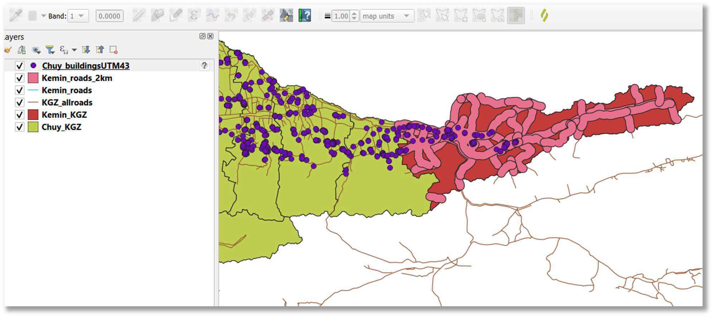
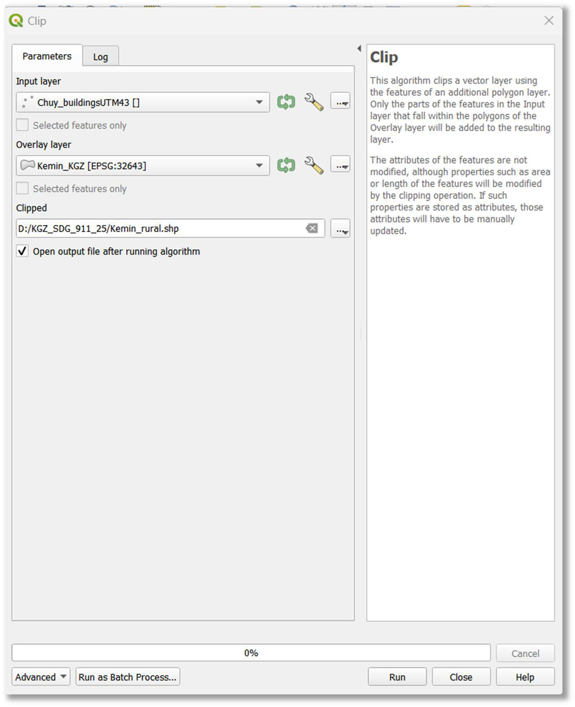
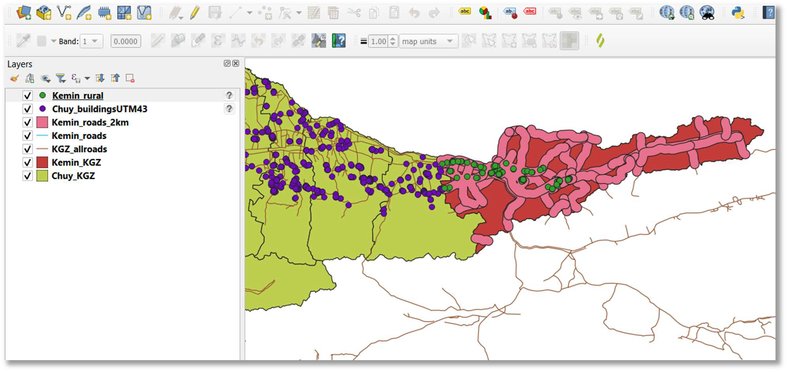

::: {.columns .home-logos-split}

::: {.column}
{.home-logo .escap}
:::

::: {.column style="text-align: right;"}
{.home-logo .sdg9}

:::

:::

# Step 3: Rural Areas Geodata Processing and Analytics

This section focuses on preparing the rural population data and aligning it with your area of interest.

**10. Add rural population data to map:** Add your vector layer containing information on rural population to the QGIS map canvas (e.g., drag-and-drop Chuy_buildingsUTM43.shp).

**11. Clip rural population to area of interest (optional for national-level analysis):** To obtain rural population points specifically within your chosen analysis area (e.g., Kemin rayon), you need to clip the broader rural population dataset.

- Open Vector > Geoprocessing Tools > Clip.
- Set 'Input layer' to your rural population layer (e.g., Chuy_buildingsUTM43.shp).
- Set 'Overlay layer' to your area of interest boundary (e.g., Kemin_KGZ.shp).
- Specify an 'Output layer' path and name (e.g., D:/SDG_911_Project/Kemin_rural.shp).
- Click 'Run'.
- Note: If producing the indicator at the national level, skip this clipping step and use your national rural population dataset directly.

