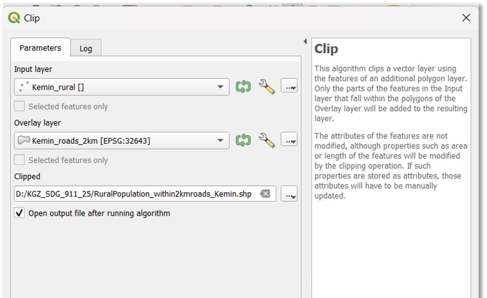
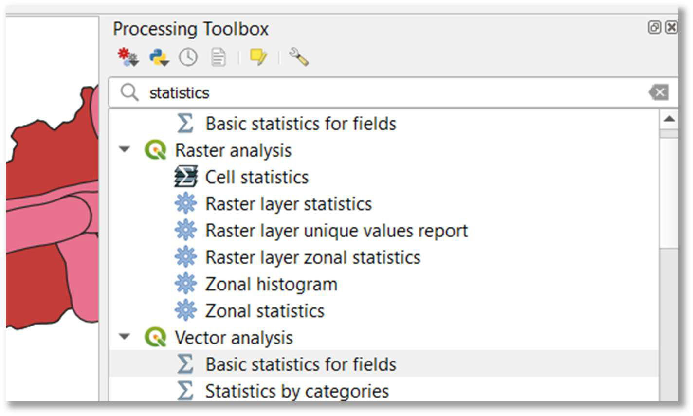
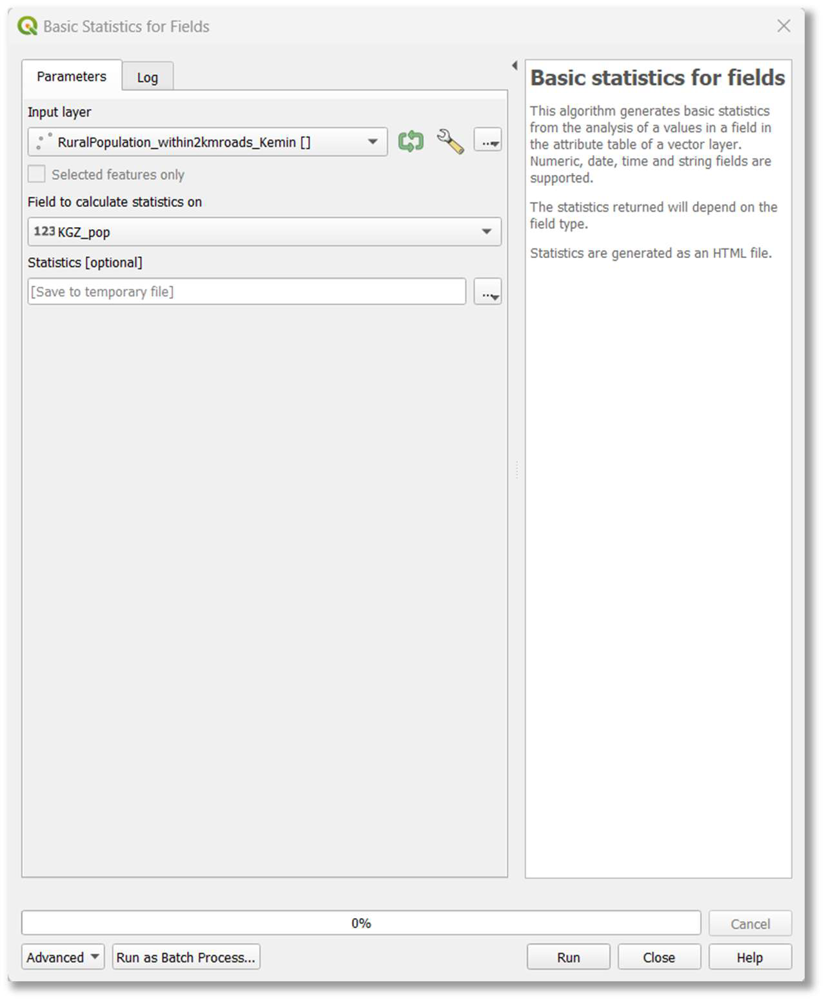
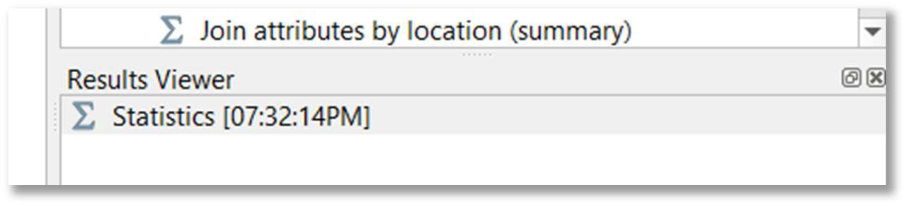
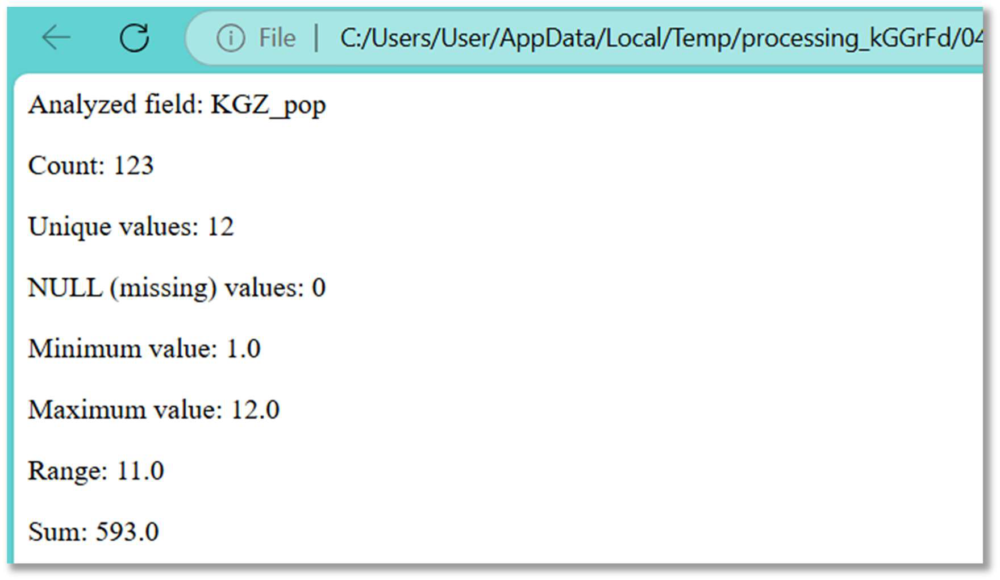
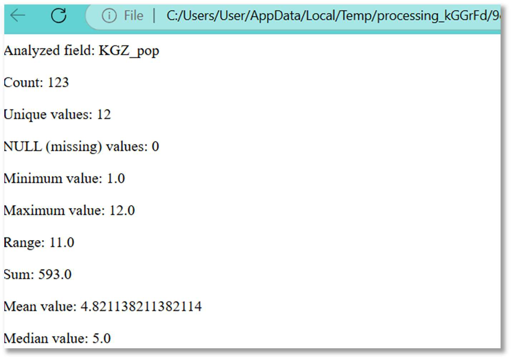
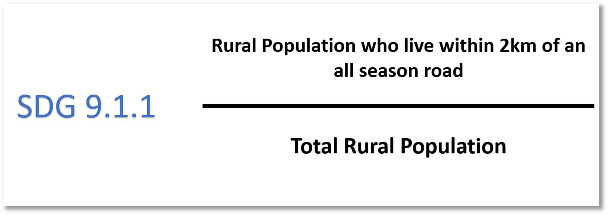

::: {.columns .home-logos-split}

::: {.column}
{.home-logo .escap}
:::

::: {.column style="text-align: right;"}
{.home-logo .sdg9}

:::

:::

# Step 4: Modeling Rural Population within 2 km of All-Season Roads

This final step involves identifying the population within the buffered road network and calculating the indicator.

**12. Identify rural population within road buffer:** To estimate the rural population residing within 2 km of all-season roads, we will again use the Clip tool. This operation will isolate only those rural population points that fall within the buffered road network.

- Choose Vector > Geoprocessing Tools > Clip.
- Set 'Input layer' to your rural population layer for the analysis area (e.g., Kemin_rural.shp).
- Set 'Overlay layer' to your 2 km road buffer layer (e.g., Kemin_roads_2km.shp).
- Specify an 'Output layer' path and name (e.g., D:/SDG_911_Project/RuralPopulation_within2kmroads_Kemin.shp).
- Click 'Run'.

**13. Calculate basic statistics for population (within buffer):** To derive the total population within the 2 km buffer, we will use the "Basic statistics for fields" tool.

- In the 'Processing Toolbox' (accessible via Processing > Toolbox), search for "statistics" and choose Vector analysis > Basic statistics for fields.
- Set 'Input layer' to the layer created in the previous step (e.g., RuralPopulation_within2kmroads_Kemin.shp).
- Set 'Field to calculate statistics on' to your population attribute field (e.g., KGZ_pop).
- Keep 'Statistics (optional)' as default or select desired statistics.
- Click 'Run'.

**14. Review statistics (population within buffer):** Open the generated HTML link in the 'Results Viewer' (or locate the temporary HTML file) to review the basic statistics for the population data within the 2 km all-season roads buffer. Note the **'Sum' value**, which represents the total rural population within 2 km of an all-season road.

**15. Generate statistics for total rural population (for analysis area):** Next, calculate the total rural population for your entire analysis area (e.g., Kemin rayon) using the same "Basic statistics for fields" tool.

- Set 'Input layer' to your total rural population layer for the analysis area (e.g., Kemin_rural.shp).
- Set 'Field to calculate statistics on' to your population attribute field (e.g., KGZ_pop).
- Click 'Run'.
- Note the **'Sum' value**, which represents the total rural population in your defined analysis area.

**Calculating SDG Indicator 9.1.1:**
The SDG Indicator 9.1.1 is calculated as the ratio of the rural population living within 2 km of an all-season road to the total rural population.

**Formula for SDG 9.1.1:**

**16. Perform calculation:** Calculate the SDG indicator using the values obtained from the statistics in steps 14 and 15. **For Kemin rayon using provided data:**

- **(1)** Rural population within 2 km of an all-season road (from Step 14): 593.0
- **(2)** Total rural population (from Step 15): 593.0
- SDG 9.1.1 = **(1)/(2)** = 593.0/593.0 = 1
- This indicates that, in this specific example, all rural population in Kemin rayon lives within 2 km of an all-season road based on the input data.

